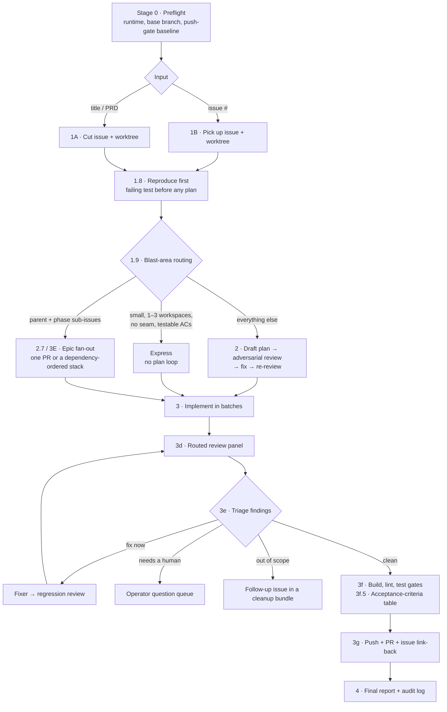

# shipflow

[](https://github.com/Jack-Heaton/shipflow-plugin/actions/workflows/test.yml)
[](LICENSE)

**An autonomous issue-to-PR pipeline that runs natively on Codex or Claude Code, or as a
hybrid with GPT models in the review seats.** Point `/ship-task` at an issue and it
reproduces the problem, has a plan attacked by a separate reviewer, implements it, sends
the diff to a panel of specialist reviewers, fixes what they find, runs the build, lint,
test and acceptance gates, and opens a mergeable pull request. It stops only at decisions
that belong to a human, and the human always makes the merge call.

```text
/ship-task 142                      # ship an existing issue
/ship-task "Retry failed webhooks"  # cut a new issue from the conversation, then ship it
/ship-task docs/prds/billing.md     # cut a parent issue + phase sub-issues from a PRD, then ship it
```

| Runtime | Orchestrator | Seats |
|---|---|---|
| **Codex** | Codex | Codex native sub-agents on GPT. No Claude account needed. |
| **Claude Code** | Claude Code | Claude agents |
| **Hybrid** | Claude Code | Review seats (and optionally writer seats) on GPT through headless `codex exec` |

The stages, gates and acceptance checks are identical on every runtime. The Codex build is
generated from the Claude source, and CI fails if the two drift apart.

## Patterns worth stealing

These ideas carry over to any agent pipeline, whether or not you use shipflow.

- **Scripts compute, the model decides.** Determinism is a free lunch. File classification,
  reviewer routing, gates, audit logging and push mechanics are zero-dependency Node scripts
  with tests that return JSON verdicts. The model only makes the judgment calls.
- **Adversarial seats.** One agent writes the plan and another attacks it. One agent writes
  the code and a routed panel reviews it. The fixer's changes are re-reviewed cold.
- **Bounded acceptance criteria.** Every "never", "all" or "100%" gets a structural `guard:`
  or a named `fixture:` set before planning. Review loops converge instead of chasing
  counterexamples forever.
- **A pipeline that improves itself from its own logs.** Every spawn logs model, effort,
  tokens and wall-clock time, and every stage logs its rounds and verdicts. `/ship-report`
  turns those logs into a post-mortem showing where runs thrashed, where emergent behavior
  showed up that needs a rule, and which model and effort tiers to change. When a new model
  ships, you can drop it into a seat, run real issues, and measure whether it earns its place.
- **A one-file tracker adapter.** Every tracker read and write goes through one CLI with a
  JSON contract. It runs on GitHub Issues out of the box and ran in production on ClickUp.
  Moving to Linear or Jira means re-implementing that one file.

## How a run works




Stage-by-stage detail, the status lifecycle and checkpoint policy are in
[docs/pipeline.md](docs/pipeline.md).

## Proof

<!-- TODO(Jack): link one real PR that shipflow opened, e.g.
**Example run:** [owner/repo#123](https://github.com/owner/repo/pull/123), opened end to end by `/ship-task`.
-->

<!-- TODO(Jack): paste a trimmed /ship-report output from a real run, e.g.
```text
(ship-report output here)
```
-->

In five weeks of daily production use the pipeline was the author's main delivery path:
321 sessions, 2,600+ sub-agent spawns and 1,000+ commits, with reviewer seats regularly
catching high-severity regressions before a human saw the diff. The numbers and the rules
they produced are in [docs/in-practice.md](docs/in-practice.md).

## Quick start

**Claude Code**

```text
/plugin marketplace add Jack-Heaton/shipflow-plugin
/plugin install shipflow@shipflow
```

**Codex**

```bash
codex plugin marketplace add .agents/plugins/marketplace.json
```

```bash
codex plugin add shipflow@shipflow
```

Then run `$ship-task <issue>` in Codex.

**Requirements:** `git`, Node ≥ 18, the GitHub CLI (`gh auth login`), and Python 3 for the
hooks and `/ship-report`. Hybrid mode also needs the Codex CLI (`codex login`).

**Per-repo configuration** (optional): a `.shipflow.json` at the repo root declares the gate
commands, the verified push command and review options. See
[`skills/shared/repo-config.md`](plugins/shipflow/skills/shared/repo-config.md). Edit the
routing table in `scripts/sf-route.mjs` to match your repo's layout.

## Further reading

- [Pipeline, stage by stage](docs/pipeline.md)
- [Agents, models and runtimes](docs/agents-and-models.md)
- [Tracker contract](docs/tracker-contract.md)
- [In practice: numbers and lessons](docs/in-practice.md)
- [Repository layout](docs/layout.md)
- [Why each rule exists, with measurements](plugins/shipflow/skills/ship-task/rationale.md)

## Development

```bash
node --test plugins/shipflow/scripts/__tests__/*.test.mjs
```

```bash
python3 -m pytest -q plugins/shipflow/hooks
```

```bash
python3 scripts/generate-codex.py --check
```

The orchestrator skill is long on purpose. The `spec-*.test.mjs` suites pin its
load-bearing rules, such as the interview policy, push gates and parallel seats, so a
rewrite that drops one fails the tests.

## License

[MIT](LICENSE)
