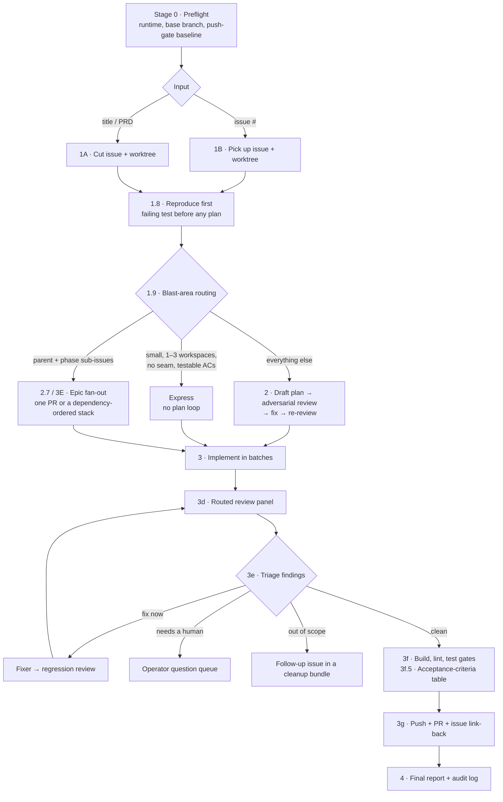

# shipflow

**An autonomous issue-to-PR pipeline for coding agents.** Point `/ship-task` at an issue and it
reproduces the problem, plans the change and has the plan attacked by a separate reviewer.
It then implements, sends the diff to a panel of specialist reviewers, fixes what they find,
runs the build, lint, test and acceptance gates, and opens a mergeable pull request. It stops
only at the decisions that belong to a human. The human always makes the merge call.

```text
/ship-task 142                      # ship an existing issue
/ship-task "Retry failed webhooks"  # cut a new issue from the conversation, then ship it
/ship-task docs/prds/billing.md     # cut a parent issue + phase sub-issues from a PRD, then ship it
```

- **Runs on Claude Code and Codex.** The same skills run natively on either host, or in a
  hybrid mode where Claude orchestrates and GPT models fill the review and writer seats.
  [→ Runtimes](#runs-on-claude-code-codex-or-both)
- **Tracks state in GitHub Issues by default, and can move to any PM tool.** Every tracker
  read and write goes through one adapter. It was built and run in production against
  ClickUp; this version runs straight off GitHub. [→ Trackers](#tracker-state-github-by-default-any-pm-platform-by-swapping-one-file)
- **Tested in daily production use.** It came out of five weeks of heavy daily use: 321
  sessions, 2,600+ sub-agent spawns and 1,000+ commits.
  [→ In practice](#in-practice)

---

## How a run works



| Stage | What happens | Why it's there |
|---|---|---|
| **0 · Preflight** | Resolves the host (Claude or Codex) and execution mode, the base branch, and a **baseline of the push-gated test suites on the base** before any code changes. | A failure that already exists on the base is reported as pre-existing, so it isn't blamed on the change and doesn't burn a fix round. |
| **1A / 1B · Issue + worktree** | Cuts a new issue (`/cut-task`), or picks up an existing one and parses its `## Requirements`, `## Acceptance Criteria`, `## Branch` and `## Base branch`. Each run gets its own branch, and its own git worktree locally. | Many runs can go in parallel without stepping on each other. |
| **1.8 · Reproduce first** | For bugs and performance or concurrency work, a seat writes a failing test that runs in the real environment and commits it as `[repro]` before any planning. | A fix gets planned against an observed failure, not a theory. |
| **1.9 · Blast-area routing** | `sf-route` classifies the likely file set (prod, test or meta files, the workspaces touched, *seams* such as auth, shared contracts, migrations and lockfiles). | Small, well-specified work takes the **express** path. Everything else gets a reviewed plan. Parent issues fan out as an **epic**. |
| **2 · Plan** | Acceptance criteria are **bounded** first: every "never", "all" or "100%" gets a `guard:` (a structural check) or a `fixture:` (a named input set). A drafter writes the plan, an adversarial plan reviewer scores it, and a plan fixer revises it, round after round, until the plan is clean. | Unbounded criteria make review loops chase counterexamples forever. Bounded ones converge. |
| **3a–3c · Implement** | The plan is split into batches. Independent batches with disjoint scopes run in parallel in scratch worktrees. Seam-touching work lands first, one batch at a time. | Parallelism where it's safe, serial order where a shared contract is moving. |
| **3d · Routed review** | `sf-route` seats a panel based on the files that actually changed: security always, plus domain reviewers (database, backend, frontend, infra, API contract, prompts, UX, test coverage), with an architecture seat when a seam is touched. | Reviewers read code they're specialists in, and the panel scales with the change's blast area. |
| **3e · Triage + fix loop** | Findings are deduped across seats, then sorted into **fix now**, **needs a human**, **out of scope** (filed as a follow-up issue right away) or **not legitimate** (dropped). A fixer applies a round's fixes, then a cold regression pass re-checks them. Two base rounds, extendable up to six. | Review findings become a bounded, auditable loop, not an argument. |
| **3f · Gates** | Build, lint, type-check and tests run as concurrent jobs through `sf-gates`. An **acceptance-criteria table** marks each criterion PASS, FAIL or `NOT VERIFIED` with the evidence. | "Done" means the criteria were checked. Anything unchecked is labeled `NOT VERIFIED`, never assumed to pass. |
| **3g · PR** | `sf-push` pushes through the repo's own verified push command, then opens or updates the PR, reads back `mergeable`, and links the PR and branch back to the issue. | The run ends on a mergeable PR and an updated issue, not just a pushed branch. |
| **4 · Report** | A final report, plus a schema-validated JSONL audit log of every stage, spawn, token count and operator wait. `/ship-report` turns the log into a cost and cycle post-mortem. | Model and effort tiers get tuned from measured runs, not vibes. |

### The status lifecycle

The workflow moves the issue through a fixed lifecycle. On GitHub each status is a single
`status:<name>` label, and the terminal statuses also close the issue.

`to do` → `planning` → `ready for development` → `in development` → `development complete`
(PR open, criteria verified). `remediating` means a draft PR still has unresolved
critical or high findings. `blocked` means a checkpoint stopped the run. Everything after
the PR opens (`ready for testing` → `testing` → `shipped`) belongs to the human.

### Checkpoints, not interruptions

The run only stops at `CHECKPOINT_REQUIRED`, which has an enumerated reason
(`preflight-failed`, `ambiguous-fix-required`, `epic-integration-conflict`, …). It writes
a run cursor first, so `/ship-task <issue>` resumes exactly where it stopped. Questions follow one
**interview policy**:

- Every question is a structured multiple-choice prompt with the recommended answer first.
- Questions that only matter for medium or low findings never interrupt the run. They're
  collected into `pr-questions.md` and asked once, after the PR is open.
- Blocking questions are **queued**. The run keeps doing every piece of work that doesn't
  depend on the answer, and asks the whole queue at once only when nothing else is left.
- New feature toggles are always the operator's call. No agent adds a flag on its own
  judgment.

## The agents

The orchestrating session does the spawning itself. Every seat writes its report to a
declared file and returns one line, and the orchestrator reads the file. Sub-agent prose
never steers the run.

| Seat | Agent | Claude default | Codex / GPT default |
|---|---|---|---|
| Plan drafter / plan fixer | `sf-plan-drafter`, `sf-plan-fixer` (+ `-complex` high-effort profiles) | session model, medium (high for consequential design) | `gpt-6.1-sol`, medium/high |
| Plan reviewer | `sf-plan-reviewer` (+ `-complex`) | session model, medium | `gpt-6.1-sol`, medium |
| Direction reviewer | `sf-direction-reviewer` (+ `-complex`) | session model, medium | host-native |
| Explore | built-in Explore | session model | host-native |
| Implementer | `sf-implementer` | Opus, high | `gpt-6.1-sol`, low (`writer` tier) |
| Fixer / mop-up | `sf-fixer` | Opus, high | `gpt-6.1-sol`, low |
| Security (always seated) | `security-reviewer` | Opus, medium | `gpt-6.1-sol`, medium |
| Routed domain reviewers | `database-reviewer`, `backend-reviewer`, `frontend-reviewer`, `infra-reviewer`, `api-contract-reviewer`, `prompt-reviewer`, `ux-consistency-lead` | Opus, medium | `gpt-6.1-sol`, medium |
| Test coverage / cold regression | `test-coverage-guardian`, regression template | Opus, medium | `gpt-6.1-sol`, medium |
| Architecture (seam touched) | general-purpose + template | Opus | `gpt-6.1-sol`, high |

The policy behind the table is in
[`skills/shared/model-tiering.md`](plugins/shipflow/skills/shared/model-tiering.md), and the
GPT seat tiers are in [`scripts/review-tiers.json`](plugins/shipflow/scripts/review-tiers.json).
The principle: choose a model capable of the decision the seat makes, then set effort by
how much risk is still unresolved. Writers can run at low effort because every commit they
make is reviewed, built and checked against the acceptance criteria.

## What makes it hold up

- **Scripts compute, the model decides.** Anything mechanical is a zero-dependency Node
  script with tests, never prose for the model to interpret. That covers file
  classification and reviewer routing (`sf-route`), audit events (`sf-log`), branch syncs
  and migration-number collisions (`sf-sync`), gates (`sf-gates`), and push and PR
  mechanics (`sf-push`). The orchestrator reads their JSON verdicts.
- **Adversarial by construction.** The plan is written by one agent and attacked by
  another. Code is written by one agent and reviewed by a panel of others. The fixer's
  changes are re-reviewed cold.
- **Scope discipline.** The goal-post rule stops a review from moving the finish line. A
  finding whose only evidence is a new counterexample outside a bounded criterion's fixture
  set is out of scope. Same-class siblings of a defect get fixed together, with a guard
  against recurrence. A defect the change *caused* is never filed as a follow-up.
- **Nothing gets parked.** Out-of-scope findings that clear a severity floor become
  sub-issues of **one cleanup bundle per run**. Each records where it came from (run, round,
  reviewer, file:line). The bundle ships as its own run right after the parent PR. Anything
  that can't ship goes to `blocked`, with the ruling it's waiting on.
- **Resumable.** A runstate cursor plus artifacts committed on the branch mean a run can
  stop on one machine and resume on another.
- **Measured.** Every spawn logs its model, effort, tokens, wall-clock time and agent id.
  `/ship-report` breaks each run down by role, finds the stages that thrashed (plan rounds,
  fix rounds, escalations), and recommends tier changes. The *why* behind each rule, with the
  measurements, is in [`skills/ship-task/rationale.md`](plugins/shipflow/skills/ship-task/rationale.md).

## Runs on Claude Code, Codex, or both

The stages, gates and acceptance checks are identical on every runtime. Only dispatch
changes. `sf-runtime` resolves the host and mode once at Stage 0 and records them in the
audit log.

| Mode | Orchestrator | Seats | Needs |
|---|---|---|---|
| `claude` | Claude Code | Claude agents (table above) | Claude Code |
| `codex` | Codex | Codex native sub-agents on GPT, including planners, security and UX | Codex CLI only, no Claude account |
| `hybrid` | Claude Code | `HYBRID_MODE=review`: review seats run on GPT through headless `codex exec`. `HYBRID_MODE=codex`: review, implementer, fixer and mop-up seats all run on GPT. Planning, Explore and the pinned security/UX seats stay on Claude. | Both |

Hybrid seats run in a read-only sandbox with a JSON output schema and write the same
artifact a Claude seat would. If a hybrid preflight fails, the run stops at a checkpoint.
It never quietly falls back to Claude. `SOLO_MODEL=opus` pins every Claude seat to one model
for controlled comparisons.

The Codex distribution under `.agents/plugins/` is **generated** from the Claude source by
[`scripts/generate-codex.py`](scripts/generate-codex.py). The generator rewrites `/skill` as
`$skill`, moves agents into role references resolved by the runtime, and stamps each skill
with a compatibility banner. CI runs `--check` so the two can't drift apart.

## Tracker state: GitHub by default, any PM platform by swapping one file

shipflow keeps its state (status, sub-issues, comments, follow-ups, PR links) in an issue
tracker, because a run spans hours, machines and humans. It was built and run in production
against **ClickUp**. This version ships pointed at **GitHub Issues**, so it runs straight
off the repo with nothing but `gh`.

Every tracker call in every skill goes through **one CLI with a JSON contract**:
[`plugins/shipflow/scripts/tracker.mjs`](plugins/shipflow/scripts/tracker.mjs).

| Concept | Contract verb | GitHub implementation |
|---|---|---|
| Task | `task view / create / edit` | Issue (id = issue number) |
| Status | `task status <id> "<status>"` | One `status:<slug>` label. `shipped` / `cancelled` close the issue. |
| Subtask / phase | `task create --parent` | GitHub sub-issue |
| Tag | `tag ensure`, `--tag` | Label |
| Comments | `task comment / comments` | Issue comments, signed `**[<skill> · <context>]**` |
| PR / branch link-back | `task pr / branch` | One sticky "Links" comment, edited in place |

To run shipflow on **ClickUp, Linear, Jira, Asana or anything else**, re-implement those
verbs against that platform's API so they emit the same JSON. Nothing else changes: no
skill, script or agent knows which tracker it's talking to. (The original ClickUp adapter
was this same CLI over ClickUp's REST API, plus two URL custom fields for the PR and branch
links.)

## In practice

These numbers come from a Claude Code usage report covering five weeks of the author's
work, when ship-task was the main delivery path. They cover all Claude Code use in the
period, not only ship-task runs.

| | |
|---|---|
| Sessions | 321 (6,853 messages over 33 days) |
| Commits | 1,073 (+53k / −2k lines) |
| Sub-agent spawns | 2,668 |
| Structured operator questions | 1,025 |
| Parallel sessions | 54% of messages sent while another session was running |
| Session outcomes (99 analyzed) | 61 fully achieved, 26 mostly, 10 partially, 1 not, 1 unclear |

**Where it worked.** The run handled one-line UI fixes and three- and four-phase epics the
same way, ending each in a mergeable PR with every acceptance criterion checked. The report
found that the reviewer seats regularly caught *high-severity regressions before a human
saw the diff*: "quality gets enforced by the process itself." The operator mostly answered
the workflow's structured questions rather than steering line by line.

**What it taught.** The friction the report found turned into rules in the skill:

- **First-pass code often had real bugs, and a fix round sometimes added a new one.** →
  Fix rounds get a cold regression review, and a defect the change caused is always fixed
  in the same run, never deferred.
- **Agents sometimes reported conclusions they hadn't verified.** → The acceptance table
  needs evidence for every PASS, and anything unchecked is labeled `NOT VERIFIED`.
  Reproduce-first makes a bug fix start from an observed failure.
- **Environment drift broke push gates on code that was actually fine.** Typical causes
  were unlinked packages, stray build output and stale branches. → Preflight measures a
  push-gate baseline on the base branch, so pre-existing failures aren't blamed on the
  change, and `sf-sync` reports how far behind the branch is.
- **Short instructions were sometimes misread.** → The interview policy uses enumerated
  options with the recommendation first, at fixed points in the run.

The natural next step, which the report also points at, is a coordinator that runs the
whole `to do` column overnight. It would start one isolated worktree run per issue and
check overlapping files and migration numbers across runs before they turn into merge
conflicts. The per-run pieces already exist: worktree isolation, migration-collision
detection in `sf-sync`, and the resumable cursor.

## Install

**Claude Code**

```text
/plugin marketplace add <your-github-user>/shipflow
/plugin install shipflow@shipflow
```

**Codex**

```bash
codex plugin marketplace add .agents/plugins/marketplace.json
```

```bash
codex plugin add shipflow@shipflow
```

Then run `$ship-task <issue>` in Codex.

**Requirements:** `git`, Node ≥ 18, the GitHub CLI (`gh auth login`), and Python 3 for the
hooks and `/ship-report`. For hybrid mode you also need the Codex CLI (`codex login`).

**Per-repo configuration** (optional): a `.shipflow.json` at the repo root declares the
gate commands (build, lint, type-check, test), the verified push command and review
options. See [`skills/shared/repo-config.md`](plugins/shipflow/skills/shared/repo-config.md).
The reviewer routing table in `scripts/sf-route.mjs` uses conventional paths (`migrations/`,
`infra/`, `*.tsx`, `*.graphql`, …). Edit that table to match your repo's layout.

## What's in the box

```text
plugins/shipflow/
  skills/
    ship-task/        the orchestrator (SKILL.md), epic fan-out (epic.md), rationale.md
    cut-task/         create a well-formed issue (Requirements / ACs / Branch / Phases)
    fix-task/         bug-first entry: reproduce, then ship
    plan-task/ review-task-plan/ implement-task/ review-task-code/
                      the same pipeline split into resumable phases, for multi-session work
    review-plan/      the plan-review rubric the plan reviewer scores against
    ship-report/      audit-log post-mortem (report.py)
    sync-branch/ create-worktree/
    shared/           contracts every stage reads: runtime, model tiering, reviewer
                      routing and prompts, scope policy, gates, warm closure, …
  agents/             planners, writers, direction reviewer, and the routed reviewer panel
  scripts/            tracker, sf-route, sf-log, sf-gates, sf-push, sf-sync, sf-codex,
                      sf-runtime, … (zero dependencies, with node:test suites)
  schemas/            JSON schemas for review findings, plan reviews, implement reports
  hooks/              safety guard, seat guard, session-resume (Python, with tests)
.agents/plugins/      generated Codex distribution (do not edit)
scripts/generate-codex.py
```

## Development

```bash
node --test plugins/shipflow/scripts/__tests__/*.test.mjs
```

```bash
python3 -m pytest -q plugins/shipflow/hooks
```

```bash
python3 scripts/generate-codex.py --check
```

The `spec-*.test.mjs` suites pin the load-bearing rules in the skill text, such as the
interview policy, push gates and parallel seats. A rewrite that drops one of those rules
fails the tests.
