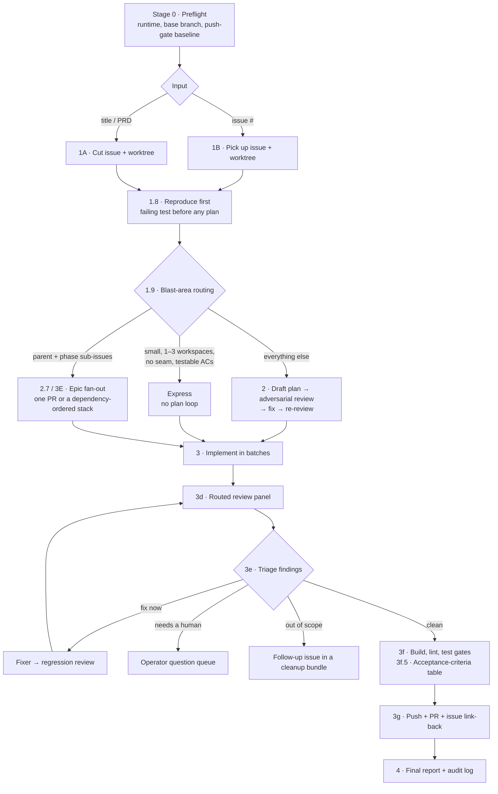

# shipflow

[](https://github.com/Jack-Heaton/shipflow-plugin/actions/workflows/test.yml)
[](LICENSE)

**An autonomous issue-to-PR pipeline that runs natively on Codex or Claude Code, or as a
hybrid with GPT models in the review seats.** Point `/ship-task` at an issue and it
reproduces the problem, has a plan attacked by a separate reviewer, implements it, sends
the diff to a panel of specialist reviewers, fixes what they find, runs the build, lint,
test and acceptance gates, and opens a mergeable pull request. It stops only at decisions
that belong to a human, and the human always makes the merge call.

```text
/ship-task 142                      # ship an existing issue
/ship-task "Retry failed webhooks"  # cut a new issue from the conversation, then ship it
/ship-task docs/prds/billing.md     # cut a parent issue + phase sub-issues from a PRD, then ship it
```

| Runtime | Orchestrator | Seats |
|---|---|---|
| **Codex** | Codex | Codex native sub-agents on GPT. No Claude account needed. |
| **Claude Code** | Claude Code | Claude agents |
| **Hybrid** | Claude Code | Review seats (and optionally writer seats) on GPT through headless `codex exec` |

The stages, gates and acceptance checks are identical on every runtime. The Codex build is
generated from the Claude source, and CI fails if the two drift apart.

## Patterns worth stealing

These ideas carry over to any agent pipeline, whether or not you use shipflow.

- **Scripts compute, the model decides.** Determinism is a free lunch. File classification,
  reviewer routing, gates, audit logging and push mechanics are zero-dependency Node scripts
  with tests that return JSON verdicts. The model only makes the judgment calls.
- **Adversarial seats.** One agent writes the plan and another attacks it. One agent writes
  the code and a routed panel reviews it. The fixer's changes are re-reviewed cold.
- **Bounded acceptance criteria.** Every "never", "all" or "100%" gets a structural `guard:`
  or a named `fixture:` set before planning. Review loops converge instead of chasing
  counterexamples forever.
- **A pipeline that improves itself from its own logs.** Every spawn logs model, effort,
  tokens and wall-clock time, and every stage logs its rounds and verdicts. `/ship-report`
  turns those logs into a post-mortem showing where runs thrashed, where emergent behavior
  showed up that needs a rule, and which model and effort tiers to change. When a new model
  ships, you can drop it into a seat, run real issues, and measure whether it earns its place.
- **A one-file tracker adapter.** Every tracker read and write goes through one CLI with a
  JSON contract. It runs on GitHub Issues out of the box and ran in production on ClickUp.
  Moving to Linear or Jira means re-implementing that one file.

## How a run works




Stage-by-stage detail, the status lifecycle and checkpoint policy are in
[docs/pipeline.md](docs/pipeline.md).

## Proof

The pull request that the same run opened, abridged and redacted (the product, schema and
infrastructure details are removed; the structure and verdicts are as shipflow wrote them):

<details>
<summary><b>Example PR body written by <code>/ship-task</code></b></summary>

> **Summary.** A dashboard now reads stored stats instead of recomputing them on every
> view. Each entity's stats are recomputed once in the background after a change, with a
> 60 s quiet period so a burst of changes leads to one recompute.
>
> **Acceptance criteria**
>
> | AC | Result | Evidence |
> |---|---|---|
> | 1. A stored row means no expensive reads on view | PASS | `storedStatsLoaders.test.ts` |
> | 2. Stored, pending, stale and missing states; banner shows freshness | PASS (visual check deferred) | `StillReadingBanner.dom.test.tsx` |
> | 3. 5 enqueues in the quiet period → 1 recompute; single flight per entity | PASS | `refreshWorker.test.ts`, `run-claim.integration.test.ts` (embedded PostgreSQL) |
> | 4. No row or an unreadable row → today's output, unchanged | PASS | `storedStatsLoaders.test.ts` (5 cases) |
> | 5. A failed recompute keeps the last good row | PASS | `refreshWorker.test.ts`, `computeStoredStats.test.ts` |
> | 6. Tenant isolation | PASS | integration test on embedded PostgreSQL |
> | 7. Durable pipeline step order unchanged | PASS | `stepOrder.test.ts` |
> | 8. Live: one upload on dev causes exactly one recompute | DEFERRED_LIVE | Needs the infrastructure deploys listed in the PR |
>
> **Verification.** Scoped build and type-check 26/26; lint ratchet 51/51 changed files, no
> new errors; acceptance suites 104 + 69 + 32 tests. One unit test fails, and it already
> fails on the base branch at the same lines (shifted by two), so it is reported as
> pre-existing. Two push-gate checks that also fail on the base were skipped with operator
> approval, and the PR says so.
>
> **Review.** Plan: 4 adversarial rounds plus a failure-over-time seat; the final round had
> no critical, high or medium findings. Code: security, architecture, failure-over-time,
> backend, infrastructure, frontend and UX seats; 0 critical / 0 high. Four medium findings
> were fixed; the regression pass came back clean; one medium finding introduced by a fix
> was bounded in mop-up. The panel cap left two reviewers unseated (API contract, test
> coverage), and the PR names them. 14 low findings are listed as residue, none a
> wrong-data defect.

</details>

A `/ship-report` from one real ship-task run (lightly redacted: tracker ID, branch and
seat names genericized; token columns omitted):

```text
=== ship-report — task <id>  (ship-task-1795037734.jsonl) ===
mode: inline   branch: feat/dashboard-stored-stats
plan rounds: 4   fix rounds: 1   wall-clock: 7h21m
wall segments: seats busy 3h55m (53%)   operator waits 2h58m (40%)   orchestrator 27m (6%)
idle after a finished seat: 35m50s (8% of wall; largest: 11m32s after explore r1)

--- wall-clock by role (32 spawns) ---
  role                          spawns     wall  models
  implementer                        5    2h16m  claude-opus-5-5/high×5
  explore                            5   50m52s  claude-opus-5-5/high×5
  plan-drafter (+ fix)               3   40m24s  claude-opus-5-5/high
  plan-reviewer (+ rereview, FoT)    5   26m54s  claude-opus-5-5/high
  fixer / mop-up                     3   27m49s  claude-opus-5-5/high×3
  reviewer:failure-over-time         2   13m26s  claude-opus-5-5/high
  reviewer:frontend-reviewer         2    9m37s  claude-opus-5-5/medium×2
  reviewer:backend-reviewer          2    9m16s  claude-opus-5-5/medium×2
  reviewer:architecture              1    7m57s  claude-opus-5-5/high×1
  reviewer:ux-consistency-lead       2    5m36s  claude-opus-5-5/medium×2
  reviewer:security-reviewer         1    4m55s  claude-opus-5-5/medium×1
  reviewer:infra-reviewer            1    3m50s  claude-opus-5-5/medium×1

--- fix-round yield ---
  round   fix-now  human  follow  dropped  re-review
  1             4      0       0        0  warm
  2             1      0       0        0  none
  → rounds ≥2 surfaced 1 new fix-now finding. Round 2+ earned its cost.

--- plan gaps (decisions the plan did not specify): semantic 14 / cosmetic 0 ---
--- warm closure: 6/6 exchanges warm (100%), 0 findings reopened ---
--- adjudication: 5 semantic gaps: 5 accepted, 1 redirected ---
--- mop-up: 1 fixed, 13 residue, 0 filed, generation-capped ---

=== tuning signals ===
  plan took 4 rounds — plan-drafter/reviewer disagreement is expensive.
```

The report shows where the run spent its time and what to tune next. Here, the second fix
round paid for itself, and the four-round plan loop is the next thing to tighten.

In five weeks of daily production use the pipeline was the author's main delivery path:
321 sessions, 2,600+ sub-agent spawns and 1,000+ commits, with reviewer seats regularly
catching high-severity regressions before a human saw the diff. The numbers and the rules
they produced are in [docs/in-practice.md](docs/in-practice.md).

## Quick start

**Claude Code**

```text
/plugin marketplace add Jack-Heaton/shipflow-plugin
/plugin install shipflow@shipflow
```

**Codex**

```bash
codex plugin marketplace add .agents/plugins/marketplace.json
```

```bash
codex plugin add shipflow@shipflow
```

Then run `$ship-task <issue>` in Codex.

**Requirements:** `git`, Node ≥ 18, the GitHub CLI (`gh auth login`), and Python 3 for the
hooks and `/ship-report`. Hybrid mode also needs the Codex CLI (`codex login`).

**Per-repo configuration** (optional): a `.shipflow.json` at the repo root declares the gate
commands, the verified push command and review options. See
[`skills/shared/repo-config.md`](plugins/shipflow/skills/shared/repo-config.md). Edit the
routing table in `scripts/sf-route.mjs` to match your repo's layout.

## Further reading

- [Pipeline, stage by stage](docs/pipeline.md)
- [Agents, models and runtimes](docs/agents-and-models.md)
- [Tracker contract](docs/tracker-contract.md)
- [In practice: numbers and lessons](docs/in-practice.md)
- [Repository layout](docs/layout.md)
- [Why each rule exists, with measurements](plugins/shipflow/skills/ship-task/rationale.md)

## Development

```bash
node --test plugins/shipflow/scripts/__tests__/*.test.mjs
```

```bash
python3 -m pytest -q plugins/shipflow/hooks
```

```bash
python3 scripts/generate-codex.py --check
```

The orchestrator skill is long on purpose. The `spec-*.test.mjs` suites pin its
load-bearing rules, such as the interview policy, push gates and parallel seats, so a
rewrite that drops one fails the tests.

## License

[MIT](LICENSE)
